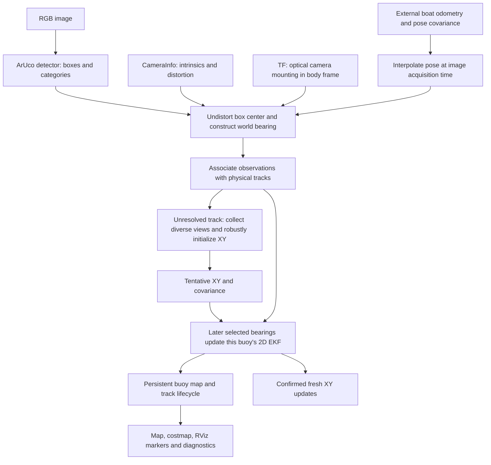

# Maritime Localization

`maritime_localization` provides **Bearing EKF Buoy Mapping (`bearing_ekf`)**.
It turns RGB detections into world bearings, initializes buoy positions from
multiple viewpoints, and maintains **one independent 2D EKF
per buoy**. It keeps physical track IDs, position uncertainty, and track state
across frames and occlusions.

**The EKFs estimate buoy positions, not the boat's pose.** Boat position and full
orientation arrive through odometry, currently MAVROS by default. This package
does not implement the FCU's navigation EKF. The mapper uses calibrated RGB
bearings, camera mounting transforms, and metric boat odometry to estimate
buoy positions from multiple viewpoints.

## Contents

- [Mapper and nodes](#mapper-and-nodes)
- [RGB data flow](#rgb-data-flow)
- [Topics in](#topics-in)
- [Topics out](#topics-out)
- [RGB localization and the EKFs](#rgb-localization-and-the-ekfs)
- [Timing and coordinate frames](#timing-and-coordinate-frames)
- [Parameters](#parameters)
- [Run it](#run-it)
- [What each file does](#what-each-file-does)
- [Debugging and validation](#debugging-and-validation)
- [Current limits](#current-limits)

## Mapper and nodes

This package provides one localization implementation: **Bearing EKF Buoy
Mapping**. The `buoy_mapper` executable runs as `/localization/buoy_mapper` under
`pipeline.launch.py`. That launch also starts an `aruco_detector` from the
neighboring [`maritime_perception`](../maritime_perception/) package per camera.
`bearing_ekf` is the method identifier used in result messages and benchmarks.
## RGB data flow



The mapper derives range from bearings observed across known camera positions.
The detector's marker IDs map to categories, currently `0=white`, `1=red`, `2=green`, `3=blue`. They do not
identify physical buoys: two red markers can produce two distinct `buoy-N` IDs.

## Topics in

These are the resolved names **when using `pipeline.launch.py` with its default
camera and namespace**. Subscriptions use sensor-data QoS unless noted. Changing
the camera name substitutes it into the camera-specific paths.

| Topic | ROS message type | Consumer and purpose |
| --- | --- | --- |
| `/sensors/camera_0/color/image_raw` | `sensor_msgs/msg/Image` | Detector input. The mapper itself subscribes to detections, not images. |
| `/perception/camera_0/detections` | `vision_msgs/msg/Detection2DArray` | Mapper input: source image header, box centers/extents, and `results[0].hypothesis.class_id` category. Detections without results are skipped. |
| `/sensors/camera_0/color/camera_info` | `sensor_msgs/msg/CameraInfo` | Mapper input: image dimensions, `K`, distortion coefficients and model, optical frame. |
| `/mavros/local_position/odom` | `nav_msgs/msg/Odometry` | Default launch remapping for the node's relative `vessel/odometry` input. Supplies boat pose, pose covariance, source stamp, and frame IDs. Override with `pose_topic`. |
| `/tf`, `/tf_static` | `tf2_msgs/msg/TFMessage` | TF listener resolves the optical camera frame into `body_frame`. The mount is assumed fixed during a session. Uses TF listener QoS. |
| `/clock` | `rosgraph_msgs/msg/Clock` | ROS time source when `use_sim_time:=true`; not a buoy measurement or automatic pose-clock converter. |

For `second_camera:=camera_1`, the detector and mapper add the corresponding
RGB, detections, and CameraInfo streams. Both cameras share one mapper and ID
space. Unresolved tracklets remain camera-local; initialized world tracks can
accept either camera's observations. Ambiguous duplicate promotions are deferred.

When executables are run directly, relative names resolve under the chosen node
namespace. For example, without launch remapping, `vessel/odometry` under
`/localization` resolves to `/localization/vessel/odometry`.

## Topics out

| Topic | ROS message type | Contents / publication behavior |
| --- | --- | --- |
| `/perception/camera_0/detections` | `vision_msgs/msg/Detection2DArray` | Detector output, retaining the source image header. Successfully processed frames with no recognized markers publish empty arrays. |
| `/perception/camera_0/debug/image` | `sensor_msgs/msg/Image` | Optional annotated detector image; enable `publish_debug_image:=true`. |
| `/localization/buoys` | `maritime_interfaces/msg/BuoyEstimateArray` | Per-frame status and **only confirmed tracks newly updated by that frame**. Includes method, readiness, detail, category, track ID, and XY. Sensor-data QoS. |
| `/mapping/buoys` | `maritime_interfaces/msg/BuoyMap` | Authoritative RGB metric-map snapshot: session ID, paused/detail fields, unresolved count, and all tracks that have XY, including tentative/stale/inconsistent tracks. Reliable, transient-local, history capacity 1. |
| `/mapping/observations` | `maritime_interfaces/msg/BearingObservationArray` | Bearings and association decisions for ready processed RGB frames, with session ID, original pose-bracket stamps and configured offset. Sensor-data QoS. |
| `/mapping/costmap` | `nav_msgs/msg/OccupancyGrid` | Derived occupied footprints from confirmed/stale/inconsistent tracks. Reliable, transient-local, history capacity 1. |
| `/mapping/markers` | `visualization_msgs/msg/MarkerArray` | All metric tracks: XY covariance ellipses and text labels with ID/category/lifecycle. Rebuilt using DELETEALL and replacement markers. Reliable, transient-local, history capacity 1. |
| `/mapping/diagnostics` | `diagnostic_msgs/msg/DiagnosticArray` | Input/solver/filter counters, queue/buffer sizes, track-state counts, processing time, stale-image flag, and paused reason. Default reliable QoS, history capacity 10. |

Map, grid, markers and diagnostics publish every **0.5 seconds of wall time**.
They retain the last processed image timestamp, even if playback stops. Frame
status and observation records publish as input frames are handled.

Important output details:

- `status=ok` and `inputs_ready=true` mean the inputs were assembled. They do
  **not** mean geometry has resolved or that an EKF update was accepted.
- An initialized tentative track appears in `/mapping/buoys` before it can appear
  as a confirmed fresh update in `/localization/buoys`. A previously confirmed
  track may remain in the map while the latest estimate array is empty.
- `BuoyTrack.covariance` is row-major `[Pxx, Pxy, Pyx, Pyy]` in m². Tracks also
  carry source cameras, first/last seen and last update times, raw/selected
  observation counts, confirmation evidence, bounded observation IDs, and the
  last EKF angular residual.
- `category_probability=1` reflects deterministic marker categorization.
  `existence_confidence = min(1, confirmation_evidence / confirmation_updates)
  * exp(-age_seconds / 60)` is an age/evidence heuristic, not a calibrated probability.
- Bearing records include camera XY origin, world azimuth and bearing variance,
  observation ID, assigned world ID if any, and decisions such as `initialized`,
  `updated`, `redundant`, `unresolved_geometry`, or `ambiguous`.
- The costmap is centered on the reference-frame origin. Unseen cells are `-1`
  (unknown); occupied cells are `100`. Each occupied disc has radius
  `footprint_radius_m + 3 * sqrt(largest covariance eigenvalue)`. No free water
  is inferred. Tentative tracks do not populate occupied cells.

Message definitions live in [`maritime_interfaces/msg`](../maritime_interfaces/msg/).
This package publishes no boat command or boat odometry topic.

## RGB localization and the EKFs

### 1. Turn a pixel into a world bearing

`mapping_node.py::build()` uses `geometry.py::camera_ray()` to undistort the box
center into an optical ray `[x/z, y/z, 1]`. It composes:

```text
T_reference_camera = T_reference_body(image_time) × T_body_camera
```

The transform translation gives the camera origin. Its rotation maps the ray
into the reference frame using full roll, pitch, yaw, and camera mounting.
The mapper keeps the horizontal azimuth `atan2(direction_y, direction_x)`.
Out-of-image centers, invalid boxes, and nearly vertical rays are rejected.

A single bearing provides direction but no metric range. Rotating in place
does not establish range. Translation across the target's line of sight provides
the baseline and parallax needed to initialize a position.

### 2. Associate observations with physical tracks

`mapping.py::BearingMapper` owns all tracks and is the single writer of their
posteriors. It first increases metric-track covariance for elapsed time, then
associates the frame's bearings:

- Categories must match; inconsistent tracks are excluded from normal matching.
- Unresolved tracks use their last world bearing and only match the same camera.
- Metric tracks predict a bearing from their XY mean and use an angular gate
  plus normalized innovation squared (NIS) gate.
- Hungarian assignment finds a frame-wide one-to-one match with explicit
  unmatched alternatives. If removing a match gives a nearly equal global cost,
  that observation is deferred as ambiguous.
- An unmatched observation can start a new `buoy-N` track, but plausible existing
  identities and near-track contradictions suppress immediate duplicates.

At least three uniquely categorized mapped targets with a coherent residual
shift can trigger whole-frame rejection as suspected shared pose/calibration
error. It does not automatically correct boat heading or calibration.

### 3. Initialize XY once using multiple views

Unresolved tracks retain selected keyframes. A new frame is selected only after
the minimum time interval and sufficient translation **or** bearing change.
The bounded history preserves the oldest view to retain baseline.

`bearing.py::initialize()` seeds a robust nonlinear angular least-squares solve
from forward-ray intersections, uses `soft_l1` loss, rejects outliers, and refits
accepted views. Default requirements include:

| Requirement | Default |
| --- | --- |
| Selected views / retained maximum | At least 4 / at most 40 |
| Useful pair baseline and parallax | At least 1 m and 5°, with parallax below 90° |
| Inliers | At least 4 and at least 75%, within 3 normalized standard deviations |
| Forward target range | 0.3–80 m |
| Accepted-view angular residual | At most 2° |
| Information-matrix condition number | At most 1,000 |
| Largest initial position standard deviation | At most 2 m |
| Initial covariance floor | Add `0.25² I` m² |

Failure leaves the track **unresolved**, with no fabricated coordinate. Success
creates a **tentative** mean and 2×2 covariance. A fit overlapping an existing
same-category metric track within the covariance gate is deferred to avoid
promoting a duplicate identity.

### 4. Update one 2D EKF for each initialized buoy

The state of each filter is just the stationary buoy position:

```text
m = [buoy_x, buoy_y]ᵀ       P = 2×2 XY covariance
```

There is no velocity, boat pose, heading bias, or camera calibration in this
state. Each new processed source time predicts a stationary mean and adds
isotropic process uncertainty:

```text
m_prior = m
P_prior = P + process_noise_m2_s × elapsed_seconds × I
```

For camera origin `c` and measured world azimuth `z`, the bearing model is:

```text
dx = m_x - c_x;  dy = m_y - c_y;  q = dx² + dy²
h(m) = atan2(dy, dx)
H = [-dy/q, dx/q]
e = wrap(h(m) - z)             # prediction minus observation, in [-π, π)
R = bearing_variance + H × camera_origin_covariance × Hᵀ
S = H × P_prior × Hᵀ + R
NIS = e² / S
```

Measurements outside the range or innovation gates are rejected. For a selected
accepted observation, `bearing.py::update()` computes:

```text
K = P_prior × Hᵀ / S
m_new = m_prior - K × e        # minus because of the residual convention above
A = I - K × H
P_new = A × P_prior × Aᵀ + K × R × Kᵀ    # Joseph covariance form
```

The result is symmetrized and its covariance eigenvalues are floored at
`position_floor_m²`. Each new selected accepted bearing is used once.
Initialization views are consumed by the initializer; the optimized result is
not repeatedly fused into its own EKF as if it were independent evidence.
Redundant adjacent frames can maintain last-seen/provenance information without
adding filter confirmation evidence.

Pose uncertainty matters too. The ROS wrapper adds position/attitude noise
floors to supplied odometry pose covariance, propagates the camera lever arm
into camera-origin uncertainty, and propagates attitude uncertainty into world
bearing variance. It doubles both bearing variance and origin covariance as
conservative inflation for omitted translation/attitude cross correlation.
These are modeling choices; they do not prove that covariance is calibrated.

### 5. Confirm, retain, or reject a track

| State | Meaning and transition |
| --- | --- |
| `unresolved` | Bearings exist, but no defensible metric initialization. Expires after 5 s without observation. Counted separately from metric map records. |
| `tentative` | XY/covariance initialized; needs 3 later selected accepted EKF updates to become confirmed. Initialization itself supplies no confirmation updates. |
| `confirmed` | Enough later filter evidence; fresh accepted updates can appear on `/localization/buoys`. |
| `stale` | A confirmed track has not been observed for more than 5 s of processed image time. Mean and ID persist; an accepted update can reconfirm it. |
| `inconsistent` | Five sustained near-track contradictions have accumulated. Retained in the map, excluded from normal association, and still represented conservatively in the costmap. |

Metric tracks do not expire through the unresolved-track timeout. IDs are scoped
by a random map-session UUID; `buoy-1` in a new session is not the same identity
as `buoy-1` in an earlier session. No map is loaded from disk on startup.

## Timing and coordinate frames

Defaults require odometry `header.frame_id=map`, `child_frame_id=base_link`, and
detections and CameraInfo naming the same optical frame. `reference_frame` and
`body_frame` can change those required names; renaming a parameter does not
transform incompatible odometry into that frame.

`timing.py::PoseBuffer` finds exact or enclosing odometry samples at each image
acquisition time. It linearly interpolates translation and covariance, and uses
quaternion SLERP for orientation. It never extrapolates or substitutes the latest
pose for a missing acquisition-time pose.

The default maximum bracket gap is 0.3 s. A frame can wait 0.5 s of wall time for
pose/calibration/TF. Pending frames are sorted by source timestamp, bounded at
60, and drained every 20 ms. Pose history holds at most 1,000 samples and 10 s.
Frames older than the last processed source time are rejected.

Odometry clock rewind, conflicting duplicate poses, excessive pose jumps,
odometry frame mismatch, changed calibration/mounting, or a per-camera image
clock rewind pause the mapping session. Pose jump checks use 15 m/s and 4 rad/s
bounds. A latched fault requires a session restart; the mapper does not silently
move the existing map into a new coordinate system.

The optional constant offset convention is:

```text
pose source stamp + pose_time_offset_s = image-clock stamp
```

Setting `use_sim_time` alone does not repair incompatible message header clocks.
Replay clock recovery is implemented outside this package in
[`Simulation/tests/evaluation/benchmarking/clock_alignment.py`](../../../../Simulation/tests/evaluation/benchmarking/clock_alignment.py).
The benchmark defaults to `POSE_CLOCK=auto` and can normalize odometry from
recorded FCU time references onto `/benchmark/vessel/odometry`. Source bags remain
unchanged. This can handle different clock rates that one constant offset cannot.

The optional managed live session has a separate experimental receipt-based
clock adapter in Monitor, publishing `/monitor/mapping/vessel/odometry`.
Its default `POSE_CLOCK=receipt` differs from the benchmark's `auto`; receipt
latency is unmeasured. See [live timing assumptions](../../../docs/LIVE_RGB_MAPPING.md).
Neither adapter estimates clock alignment from buoy coordinates or feeds truth
into this mapper.

Track aging and EKF process noise advance with processed source image time.
If images stop completely, the map retains its previous stamp/state while
diagnostics warn after 2 s of wall time. A wall-time timer does not keep aging
the source-time posterior during paused replay.

## Parameters

Every field of [`MappingSettings`](maritime_localization/mapping.py) is exposed
as `bearing_ekf.<field>`. Node-level settings do not have that prefix. Parameters
are read at startup; restart to apply changes.

| Node parameter | Default | Purpose |
| --- | --- | --- |
| `reference_frame`, `body_frame` | `map`, `base_link` | Required output/odometry frames and mounting target. |
| `cameras` | `[camera_0]` | Camera names sharing one map. Launch sets this from camera arguments. |
| `pose_time_offset_s` | `0.0` | Explicit verified constant timestamp offset. |
| `max_pose_gap_s`, `pose_wait_s` | `0.3`, `0.5` s | Interpolation gap limit and wall-time input wait. |
| `max_pending_frames` | `60` | Bound on queued detection arrays. |
| `costmap_extent_m`, `costmap_resolution_m` | `100.0`, `0.1` m | Square extent and cell size; default is 1,000×1,000 cells. |

The following covers all `bearing_ekf.*` settings. Initialization gates are
explained above; these remain experiment defaults, not mission acceptance limits.

| Settings | Defaults | Role |
| --- | --- | --- |
| `min_range_m`, `max_range_m` | `0.3`, `80.0` m | Initialization/prediction range bounds. |
| `min_baseline_m`, `min_parallax_deg` | `1.0` m, `5.0`° | Observable initialization geometry. |
| `min_views`, `max_views`, `max_tracks` | `4`, `40`, `128` | Initialization evidence/history and total track capacity. |
| `solver_iterations`, `solve_interval_s` | `60`, `0.5` s | NLS evaluation budget and source-time solve spacing. |
| `inlier_sigma`, `min_inlier_fraction` | `3.0`, `0.75` | Robust initialization inlier tests. |
| `max_residual_deg`, `max_condition`, `max_initial_std_m` | `2.0`°, `1000.0`, `2.0` m | Initialization fit/observability/uncertainty gates. |
| `bearing_std_deg` | `1.0`° | Base bearing noise before pose contributions/inflation. |
| `pose_position_floor_m`, `pose_attitude_floor_deg` | `0.15` m, `1.0`° | Added pose uncertainty floors. |
| `position_floor_m` | `0.25` m | Initial added variance and posterior minimum principal standard deviation. |
| `keyframe_distance_m`, `keyframe_angle_deg`, `min_update_interval_s` | `0.2` m, `2.0`°, `0.2` s | Time separation plus translation or bearing change for selected evidence. |
| `association_angle_deg`, `gate_chi2` | `8.0`°, `9.0` | Angular and normalized innovation gates. |
| `unmatched_cost`, `ambiguity_cost_margin` | `8.0`, `1.0` | Unmatched alternative cost and minimum global assignment separation. |
| `confirmation_updates`, `inconsistent_after` | `3`, `5` | Later accepted updates to confirm / sustained contradictions to mark inconsistent. |
| `tentative_timeout_s`, `stale_after_s` | `5.0`, `5.0` s | Unresolved expiry / confirmed-track staleness. Despite its name, `tentative_timeout_s` removes tracks with no metric mean, not initialized tentative tracks. |
| `process_noise_m2_s` | `0.0025` m²/s | Isotropic covariance growth for stationary targets. |
| `footprint_radius_m` | `0.35` m | Physical footprint before uncertainty inflation. |
| `shared_shift_deg` | `3.0`° | Coherent residual-shift rejection threshold. |

[`config/bearing_ekf.yaml`](config/bearing_ekf.yaml) supplies a starter subset.
The launch file does **not** load it automatically; omitted settings use code
defaults. Pass `mapper_parameters` to load it explicitly.

## Run it

For the existing simulation workflow, run from the **repository root**:

```bash
make -C autonomy mapping-build
make -C autonomy mapping
```

Start Simulation and teleop separately as described in
[the live mapping guide](../../../docs/LIVE_RGB_MAPPING.md). The optional session
starts detection, mapping, its clock adapter and monitoring. Closing it stops
that session. It does not arm or drive the boat. Use `VIEW=none` for no popup.

For direct ROS use, first build/source the autonomy workspace in an environment
with its ROS dependencies installed, then:

```bash
ros2 launch maritime_localization pipeline.launch.py method:=bearing_ekf
```

Optional examples:

```bash
# Two cameras, one map manager.
ros2 launch maritime_localization pipeline.launch.py \
  method:=bearing_ekf camera:=camera_0 second_camera:=camera_1

# Use a compatible project odometry source and an explicit parameter file.
ros2 launch maritime_localization pipeline.launch.py \
  method:=bearing_ekf pose_topic:=/state/odometry \
  mapper_parameters:="$(ros2 pkg prefix maritime_localization)/share/maritime_localization/config/bearing_ekf.yaml"

```

For a recorded experiment, run from **`Simulation/`**:

```bash
make benchmark-build
make benchmark RECORDING=Sample_1 METHOD=bearing_ekf
```

The benchmark launches the production detector/mapper, plays selected inputs,
records results, and exports artifacts under
`Simulation/logs/benchmarks/<recording>/bearing_ekf-<run>/`. Do not launch a second
player or mapper on its domain. For a separately managed manual bag player, use
`use_sim_time:=true` and compatible input clocks on the same isolated ROS domain.

Key artifacts are `final_map.json`, `map_history.csv`, `observations.csv`,
`estimates.csv`, `scatter.png`, result `bag/`, reports/settings/provenance, and
node/player/recorder logs. Clock recovery additionally produces
`clock-alignment.json` and `pose-clock.csv`. The CSV/scatter of estimates contains
confirmed fresh updates, not every map snapshot. The ROS mapper itself does not
write these files; the evaluation tooling records and exports its topics.

## What each file does

Paths below are relative to this package directory.

| File | Responsibility / where to look |
| --- | --- |
| [`maritime_localization/mapping_node.py`](maritime_localization/mapping_node.py) | ROS wrapper for RGB mapping. `receive_pose()` validates/buffers odometry; `receive_calibration()` detects calibration changes; `receive()` queues frames; `build()` creates uncertain world bearings; `drain()` handles timing and calls the mapper; `publish_status()` emits frame results; `publish_map()` builds semantic map, costmap, RViz markers, and diagnostics. |
| [`maritime_localization/mapping.py`](maritime_localization/mapping.py) | ROS-independent track manager. `MappingSettings` defines algorithm defaults; `WorldTrack` holds one identity's evidence and posterior; `BearingMapper._cost()`/`_assign()` handle association; `process()` handles prediction, initialization, EKF updates, lifecycle and bounded memory. `snapshot()` returns metric tracks only. |
| [`maritime_localization/bearing.py`](maritime_localization/bearing.py) | Planar estimation math. `Bearing` stores one uncertain acquisition-time observation; `wrap()` normalizes angles; `prediction()` computes residual/Jacobian/noise; `initialize()` performs robust NLS; `update()` performs gated Joseph-form EKF correction and covariance flooring. |
| [`maritime_localization/timing.py`](maritime_localization/timing.py) | `TimedPose` and bounded `PoseBuffer`: exact/bracketed lookup, position/covariance interpolation, quaternion SLERP, clock/reset/motion-discontinuity checks. No arrival-time offset estimation. |
| [`maritime_localization/geometry.py`](maritime_localization/geometry.py) | Shared calibrated geometry: `validate_observation()`, undistorted `camera_ray()`, vector `angle()`, and quaternion/translation `rigid_transform()`. Supports plumb-bob, rational-polynomial and equidistant distortion. |
| [`maritime_localization/interfaces.py`](maritime_localization/interfaces.py) | Plain Python `Observation` dataclass carrying acquisition time, camera frame, intrinsics, distortion, camera-to-reference transform, and reference frame for calibrated bearing geometry. This is not a ROS message definition. |
| [`maritime_localization/__init__.py`](maritime_localization/__init__.py) | Python package initializer. |
| [`launch/pipeline.launch.py`](launch/pipeline.launch.py) | Shared live/replay launch. Starts per-camera detectors and one shared buoy mapper; supplies namespaces/topic remaps and launch arguments. Shuts down the pipeline if a process exits. A second camera requires a distinct name. |
| [`config/bearing_ekf.yaml`](config/bearing_ekf.yaml) | Example parameters scoped to `/localization/buoy_mapper`; starter frame/timing/grid/noise/initialization/confirmation settings. |
| [`package.xml`](package.xml) | ROS package metadata, `ament_python` build type, and runtime dependencies including perception/interfaces, NumPy/SciPy/OpenCV, ROS messages, TF and launch. |
| [`setup.py`](setup.py) | Python installation, ROS resource/config/launch installation, and console entry point `buoy_mapper`. |
| [`setup.cfg`](setup.cfg) | Installs executable scripts under `lib/maritime_localization` for ROS discovery. |
| [`resource/maritime_localization`](resource/maritime_localization) | Ament index marker enabling ROS package discovery. |
| `README.md` | This package-level explanation and interface reference. |

Related code outside this package:

| Location | Role |
| --- | --- |
| [`../maritime_perception/`](../maritime_perception/) | ArUco box detector, ROS image wrapper, detection-message conversion, category configuration. |
| [`../maritime_interfaces/msg/`](../maritime_interfaces/msg/) | ROS schemas for estimates, map/track records and bearing records. |
| [`Simulation/tests/evaluation/benchmarking/`](../../../../Simulation/tests/evaluation/benchmarking/) | Replay orchestration, clock normalization, result recording/export and algorithm/ROS tests. |
| [`autonomy/docs/LIVE_RGB_MAPPING.md`](../../../docs/LIVE_RGB_MAPPING.md) | Managed live session, plotting, clock adapter and provisional truth-view alignment. |
| [`Simulation/docs/RGB_BUOY_MAPPING.md`](../../../../Simulation/docs/RGB_BUOY_MAPPING.md) | Experiment design, replay clocks, artifacts, limits and recorded validation evidence. |

## Debugging and validation

With the autonomy ROS workspace sourced and the pipeline's ROS domain selected:

```bash
ros2 node info /localization/buoy_mapper
ros2 topic hz /perception/camera_0/detections
ros2 topic echo /localization/buoys
ros2 topic echo /mapping/buoys --qos-durability transient_local
ros2 topic echo /mapping/diagnostics
```

| Symptom | What to inspect |
| --- | --- |
| Detections arrive, no metric tracks | `unresolved_count`, selected views, `initializer_attempts`, and observation decisions. Translate enough to provide baseline/parallax; turning in place is insufficient. |
| Map contains tentative tracks, estimate arrays empty | Wait for three later selected accepted EKF updates. Inspect confirmation evidence and `redundant`/`innovation_rejected` decisions. |
| `waiting_for_inputs` | Read `detail`: missing calibration/TF, incompatible frame IDs, missing pose brackets, excessive interpolation gaps, or clock mismatch. Inspect original image and pose stamps. |
| `paused=true` | Read the latched reason. Resolve the pose/clock/frame/calibration/mount issue and restart the mapping session. |
| Same-category observations deferred | Inspect ambiguity decisions and gating. Categories do not guarantee physical identity; overlap may remain unresolved. |
| Delayed/dropped frames | Inspect `queue_overflow`, `pose_or_calibration_timeout`, `late_frame_rejected`, pending frames, and detector replacement counters in logs. The detector keeps only one active and one replaceable pending image. |
| Map keeps publishing while replay is paused | Expected: wall timers republish the last source-time state; `stale_image_input` warns after 2 s. |
| Large costmap footprints | Check track covariance and lifecycle. Footprints include a 3σ allowance, and stale/inconsistent tracks remain obstacles. |

Repository validation commands, run from **`Simulation/`**:

```bash
make validate
make benchmark-build
make benchmark-test
```

Existing algorithm tests live in `test_mapping.py` (geometry, association,
lifecycle, filtering, covariance and pose buffer), `test_mapping_node.py` (ROS
input/timing/frame/output gates) under the evaluation directory. Calibrated ray/distortion tests live in
`test_geometry.py`. The benchmark suite also exercises production
ROS launch/replay/export and clock recovery. See the linked design guide for
recorded results; successful replay alone does not establish localization accuracy.

Validation (2026-10-17): rebuilt autonomy, benchmark and live-viewer
images; 58 benchmark tests, 5 live mapping/viewer tests and 11 recording-menu
tests passed. The full ROS fixtures produced confirmed XY updates with and
without recorded-reference clock recovery. Installed-image inspection verified
the `buoy_mapper` executable. Static `make validate` passed; its Gazebo SDF checks were skipped because
that invocation could not find the simulator image. These checks establish
software behavior, not on-water localization accuracy.

## Current limits

- Buoys are modeled as stationary planar landmarks. There is no moving-target
  state, joint boat/landmark estimation, historical bundle adjustment, or route planner.
- Box centers approximate target centers. Marker faces can be offset from buoy
  centers and move as the face rotates; their apparent positions can bias the fit.
- Shared heading, position, calibration and timing biases can affect many tracks.
  Independent EKFs do not retain all boat/landmark or inter-landmark correlations.
- Bounded tracks/history, ambiguous same-category views and weak geometry can
  leave targets unresolved. Restarting creates an empty map and new session ID.
- Default noise, gates and footprint sizes need physical-camera/on-water
  calibration. Synthetic/replay behavior is separate from hardware and navigation
  readiness. A costmap with unknown water does not establish safe free space.
- Simulator truth can be used by separate evaluation/viewing tools. It is not
  a runtime localization input or an automatic accuracy guarantee.
