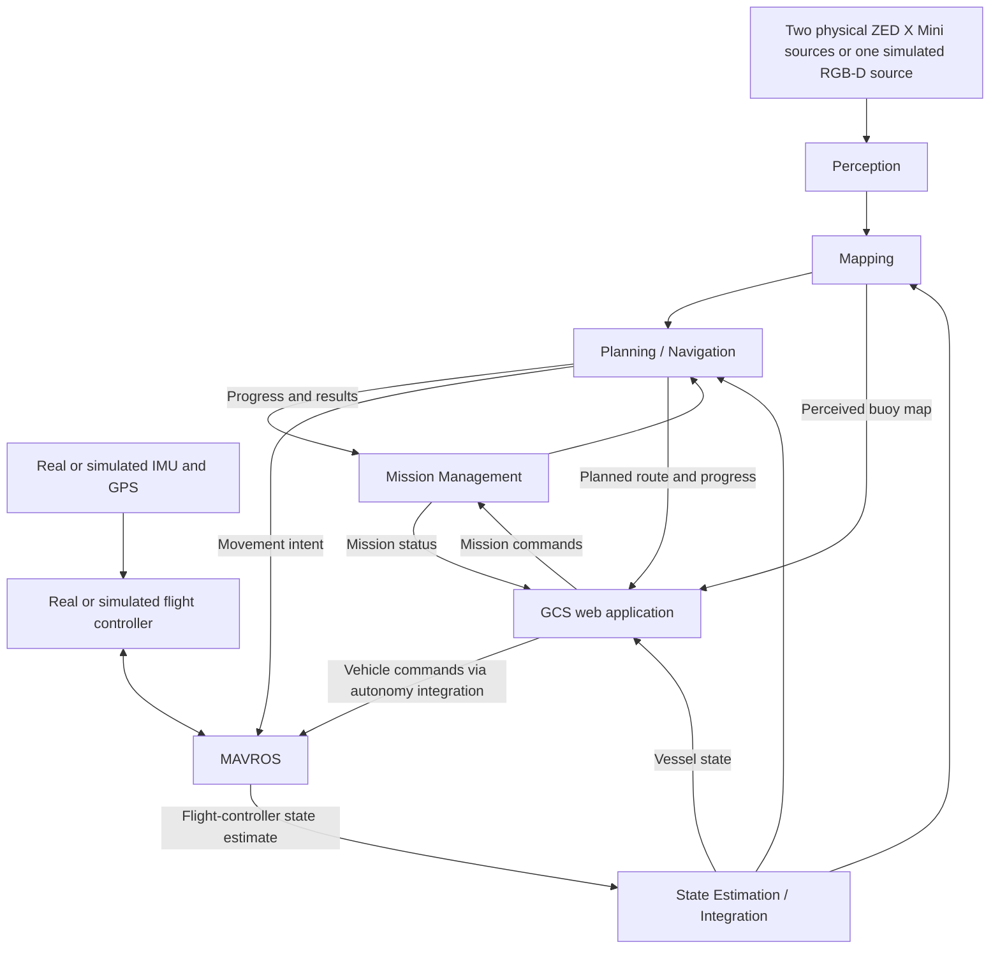

# Maritime 2027 High-Level Design

## Purpose and Design Status

This document translates the [Project Overview](Project_Overview.md) into the
major components, responsibilities, deployment boundaries, and project
organization needed to develop autonomous buoy navigation.

It records the agreed architectural direction. The folder layout below is a
proposed organization for future work, not a description of an implemented
system. Detailed interfaces, algorithms, control commands, and operational
policies will be decided during component design.

Competition-specific behavior remains subject to the release and review of the
2027 requirements. Refer to the [official AIMM ICC website](https://www.trine.edu/innovation-one/aimm/index.aspx)
for competition information; previous course material provides context rather
than a final specification.

## Architectural Direction

All autonomy will run onboard the real vessel using a Jetson Orin Nano. The
planned sensing and control foundation consists of two ZED X Mini stereo
cameras connected through the provided capture-card hardware and MIPI cabling,
GPS-assisted positioning, and an autopilot flight controller equipped with an
IMU and GPS. The flight controller will provide the primary vessel-state
estimate. MAVROS is the intended communication layer between ROS 2 and the
flight controller.

The same autonomy components should operate in simulation and on the real boat.
Their environment-facing connections change between simulated observations and
physical sensors and between simulated and physical autopilots. Simulation
should support development of a useful autonomy system without requiring a
complete physical replica of the competition vessel.

### Camera Deployment and Simulation Boundary

The real vessel and the current simulator intentionally use different camera
configurations:

| Environment | Camera configuration | Intended use |
|---|---|---|
| Real vessel | Two physical ZED X Mini stereo cameras connected to the Jetson through capture-card hardware and MIPI cabling. | Supply the two real-camera observation streams used for buoy perception and depth estimation. |
| Current simulation | One generic Gazebo RGB-D camera producing paired RGB and ideal depth. | Establish the initial perception, mapping, and navigation data path with one controlled observation source. |

The simulated camera is not a digital replica of a ZED X Mini and does not
represent the planned two-camera arrangement. It supplies a bounded RGB-D test
source while the autonomy interfaces are developed.

Perception should consume camera observations, calibration, and transforms
through a camera-neutral boundary. Simulation bringup will provide one source;
physical-vessel bringup will provide two independently calibrated ZED X Mini
sources. This change in source count must not require different mapping,
planning, or mission-management responsibilities.

The current simulator's `zed2i_*` frame names are implementation identifiers
from its initial RGB-D model. They do not identify the target flight cameras.
Detailed interface design should either normalize those names in the simulation
adapter or replace them with camera-neutral frame names before autonomy code
depends on them.

The initial application deployment has three containers:

| Container | Responsibilities |
|---|---|
| Simulation | Water environment, simulated vessel, sensors, autopilot, scenarios, and evaluation references. |
| ROS 2 / Autonomy | Sensor integration, perception, state estimation, mapping, mission management, planning/navigation, and MAVROS. |
| GCS | Web application and backend for visualization, telemetry, and operator commands. |

Project-managed application services should be containerized. Physical devices,
flight-controller firmware, host device drivers, and the operator's browser
remain outside these application containers. Hardware access and deployment
requirements will be resolved during integration.

## Component Responsibilities

Components have distinct responsibilities even when they share a container.
Each should have its own focused project area and defined exchanges with the
rest of the system.

| Component | Responsibility | Main information produced |
|---|---|---|
| Perception | Interpret camera observations to detect and distinguish buoys and estimate their locations relative to the sensor or vessel. | Buoy observations, relative positions, and confidence. |
| State Estimation | Receive and integrate the flight controller's primary vessel-state estimate, based on its IMU and GPS, through MAVROS. | Vessel position, orientation, and motion used by mapping, navigation, and visualization. |
| Mapping | Combine buoy observations with vessel state to maintain a GPS-referenced map of perceived buoys during the mission. | Estimated buoy locations and their spatial relationships. |
| Planning / Navigation | Use the perceived map, vessel state, and mission objective to determine and execute an appropriate route. | Planned route, navigation progress, and movement intent. |
| Mission Management | Maintain the active objective and coordinate the autonomy components as the mission progresses. | Mission objectives, mission state, and completion status. |
| Simulation | Provide controllable environments and simulated inputs for exercising the autonomy system. | Simulated sensor and vehicle information; separate evaluation references. |
| GCS | Present the vessel's perceived environment and mission progress and provide operator authority. | Operator commands and mission selections. |

### Perception and Mapping

Perception describes what the cameras observe. Mapping combines those
observations over time with the vessel's estimated position to build a useful
representation of the surrounding buoys.

The initial mapping objective is to discover and locate buoys during each
mission. It does not depend on a prepared map of exact buoy positions. GPS
provides a global reference, while camera observations supply local buoy
information.

### State Estimation

The flight controller is the primary source of vessel position, orientation,
and motion estimates, using its IMU and GPS. These estimates reach the onboard
ROS 2 autonomy system through MAVROS.

The ROS 2 State Estimation component primarily integrates and exposes that
information consistently for mapping, navigation, and visualization. A separate
custom estimator on the Jetson is not part of the initial design. Supplemental
sources may be considered later if needed.

This vessel-state reference lets mapping place buoy observations in the
environment and lets navigation assess progress. Estimating the vessel's state
and mapping the surrounding buoys remain distinct responsibilities.

### Planning / Navigation and Mission Management

Mission management determines the current objective and tracks its progress.
Planning/navigation determines how the vessel moves to accomplish that
objective. Keeping these responsibilities separate allows mission behavior and
navigation methods to evolve independently.

The planning framework remains open. Nav2 is a candidate, not an architectural
requirement. The movement interface through MAVROS will be selected to suit the
chosen approach; this document does not choose position targets, velocity
commands, or another command form.

## Overall Information Flow

The following diagram shows conceptual exchanges, not ROS topics or exact
message interfaces.



The GCS backend connects operator actions to the autonomy system's mission and
vehicle-control capabilities. MAVROS provides the flight-controller connection.
The exact GCS transport, command coordination, and API belong to detailed
design.

Simulation ground truth is available for evaluation only. It must not supply
the buoy map or replace the observations and estimates used to navigate.

## Container Boundaries and Deployment

### Simulation Container

This container owns the simulated environment and vehicle, including the
simulated autopilot and the current single generic RGB-D camera. Scenarios
provide repeatable ways to exercise buoy detection, map construction, and
navigation.

Its purpose is to produce meaningful development and evaluation conditions.
Physical fidelity should be sufficient for the behavior being tested, with
limitations documented when interpreting results.

### ROS 2 / Autonomy Container

The initial design places perception, state estimation, mapping,
planning/navigation, mission management, and their integrations in one ROS 2
container. These remain separate components within that deployment unit.

This grouping keeps closely connected autonomy components together and gives
the project a manageable starting deployment. Separate component folders and
interfaces preserve the option to split services later if measured resource
needs, dependency conflicts, or deployment requirements justify it.

On the real vessel this container runs on the Jetson Orin Nano and connects to
the physical cameras and flight controller. In simulation it connects to the
simulated equivalents. Sharing the autonomy components does not require the
desktop and Jetson to use an identical binary image; platform-specific builds
and hardware integration may be necessary.

### GCS Container

The GCS container hosts the web application and its backend. The initial design
keeps them together as one application service. Its physical deployment location
will be chosen later; all autonomous mission processing remains onboard the
vessel regardless of where the GCS is hosted.

The operator views the application through a browser. The GCS is a lower
development priority than the core autonomy capabilities.

## GCS Experience and Authority

The intended GCS experience is a Tesla-like visualization of the vessel and its
perceived surroundings: a 3D rendering of a primarily two-dimensional
navigation map, with an optional top-down area view.

The display should present the boat, perceived buoy detections and mapped
locations, and relevant mission and navigation information. It should represent
what the autonomy system believes about the environment. Evaluation-only
simulation truth must remain distinguishable from that perceived environment.

The GCS will provide operator authority to arm and disarm the vessel and start
and stop missions. Detailed interaction design, manual steering, command
arbitration, and connection-loss behavior are separate design decisions.

## Proposed Project Organization

Organize the repository by responsibility, with container configuration close to
the application it deploys. The following is a proposed future structure:

```text
Maritime_2027/
├── docs/
│   ├── Project_Overview.md
│   └── High_Level_Design.md
├── Simulation/
│   ├── container/
│   ├── worlds/
│   ├── models/
│   ├── scenarios/
│   └── evaluation/
├── autonomy/
│   ├── container/                  # Dockerfile and container startup
│   └── ros_ws/                     # One ROS 2 workspace
│       ├── src/
│       │   ├── maritime_perception/
│       │   ├── maritime_state/
│       │   ├── maritime_mapping/
│       │   ├── maritime_navigation/
│       │   ├── maritime_missions/
│       │   └── maritime_bringup/
│       ├── build/                  # Generated by colcon; excluded from Git
│       ├── install/                # Generated by colcon; excluded from Git
│       └── log/                    # Generated by colcon; excluded from Git
├── gcs/
│   ├── container/
│   ├── frontend/
│   └── backend/
└── deployment/
```

The autonomy application uses one ROS 2 workspace, `autonomy/ros_ws/`, with
focused packages under `src/`. A workspace groups packages for development and
building together. Each package owns a focused set of code, configuration,
launch files, and dependency declarations; it may provide one or more running
ROS nodes. The autonomy container supplies the dependencies and runs those
nodes. Docker does not require a separate workspace or container per package.

The package names above are proposed boundaries, not a requirement to create
empty packages immediately. In particular, `maritime_state` may initially need
only configuration to integrate flight-controller estimates received through
MAVROS. Additional code should follow actual requirements.

`maritime_bringup` holds launch files and configuration for starting the
appropriate nodes in simulation or on the real boat. MAVROS and camera drivers
are dependencies to configure and launch; they do not require a custom
`integrations` package unless a concrete integration need emerges.

`autonomy/container/` holds the Dockerfile and container startup configuration.
`deployment/` holds configuration for running the application containers
together in simulation or on the vessel. The workspace's generated `build/`,
`install/`, and `log/` directories must be excluded from Git.

Adopting this proposed layout will require a separate implementation step.

## Development and Evaluation Priorities

Development should first establish the simulation-to-autonomy connection, then
build perception, vessel-state integration, and the perceived buoy map. Planning,
navigation, and mission management can build on those capabilities to demonstrate
complete buoy-navigation runs.

Evaluation should connect component behavior to mission outcomes: usable buoy
observations, consistent maps, appropriate routes, and repeatable navigation
through representative scenarios. Real-water trials are needed to assess the
behavior beyond simulation. Numerical acceptance thresholds and detailed test
procedures belong in subsequent requirements and verification work.

The richer GCS experience follows the core autonomy work. Its eventual
visualization should consume the same state, map, and mission information that
the autonomy system uses.

## Decisions Reserved for Detailed Design

The following remain open without blocking this component structure:

- Perception methods, mapping methods, and detailed integration of
  flight-controller state estimates.
- Selection of Nav2 or another planning/navigation approach.
- Exact ROS interfaces, coordinate-frame conventions, and control command forms.
- GCS hosting location, web technologies, and communication transport.
- Detailed mission behavior, operator interaction, and response to failures or
  lost connections.
- Hardware integration, software versions, resource budgets, and any justified
  changes to container boundaries.

Future contributors and AI agents should preserve the agreed responsibilities
while treating these open items as decisions to resolve in the relevant
component design. This document establishes the structure; it does not imply
that the proposed deployment or hardware compatibility has already been tested.
