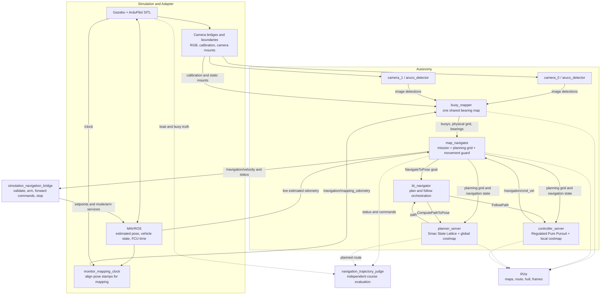
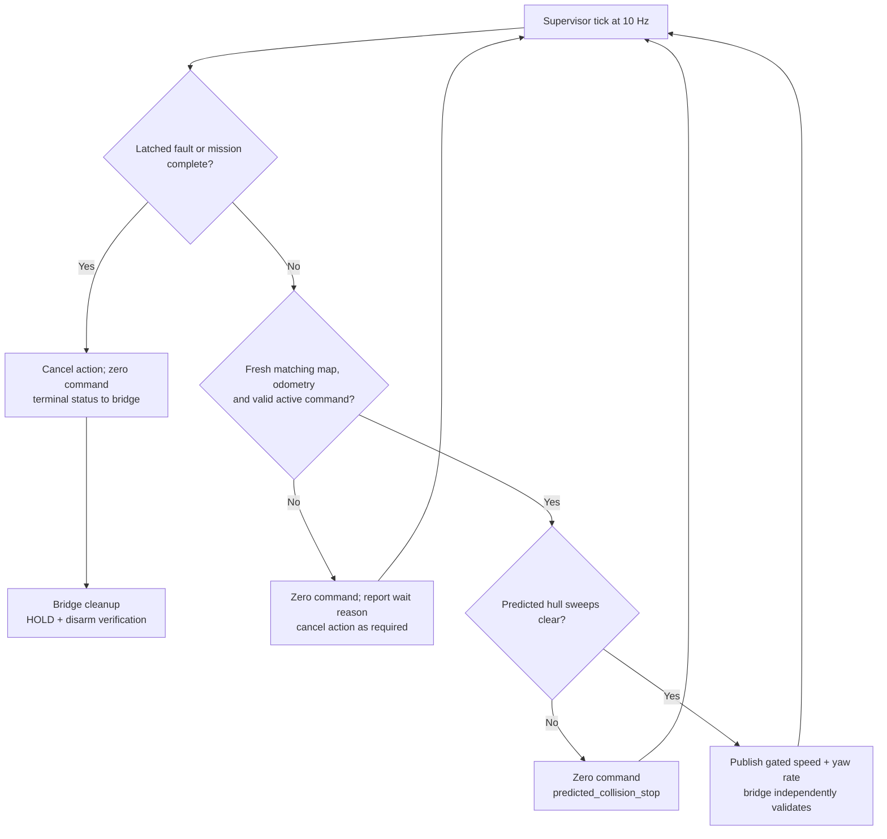

# Experimental navigation: system overview

This is a reading guide to `experiment/nav2-course-tuning`, reviewed against
the branch source on 2026-10-21. Start here for architecture; use the
[experiment README](../autonomy/experiments/README.md) for trial commands and
results, and [navigation operation](GATE_SLALOM_NAVIGATION.md) for detailed
startup and interface rules.

Jump to [data flow](#runtime-data-flow), [node responsibilities](#what-each-node-does),
[map representations](#the-three-map-representations), [stop behavior](#what-happens-when-movement-stops),
[monitoring](#time-rates-and-monitoring), or [speed development](#speed-development-toward-1-ms).

The boat observes buoys in RGB images, estimates their positions over time,
chooses the next course goal, asks Nav2 for a route, and checks each movement
command before passing it to ArduPilot. The shared map is the link between
perception and navigation.

## Read the system in six steps

1. **Observe:** one detector per camera finds ArUco-marked buoys and publishes
   their image boxes and categories.
2. **Remember:** one shared mapper combines camera bearings with vessel poses
   to maintain buoy identities, positions, uncertainty and track state.
3. **Choose:** the mission code selects a goal from those mapped buoys: entry
   gate, alternating turns, then exit gate. A single XY/yaw goal is also supported.
4. **Plan:** Nav2 finds a route through a derived planning grid and computes
   forward speed and yaw rate to follow it.
5. **Check:** the supervisor stops commands when inputs are stale, a fault is
   latched, or a predicted hull sweep reaches an obstacle.
6. **Execute:** the simulation command bridge owns GUIDED mode, arming, vehicle
   setpoints, and verified HOLD/disarm at the end of its session.

The real boat's ability to reach **1 m/s**, as reported by the project owner,
is a future tuning target. This branch defaults to **0.20 m/s**, provides an
optional **0.35 m/s** profile, and currently rejects commands above **0.50 m/s**
in both the supervisor and command bridge. See [speed development](#speed-development-toward-1-ms).

## Runtime data flow

Solid arrows below carry data, goals, or commands. Dashed arrows are observation
for evaluation/display. The two detector instances feed one map. The command
returns from Nav2 to the supervisor before it can reach the vehicle.



The judge reads the scenario manifest and simulator truth to score the run.
Its results do not supply positions or goals to navigation. A failed judge
ends the evaluated session through the host runner. The autonomy algorithms
consume RGB observations and estimated vessel state; depth and simulator truth
are not mapping or navigation inputs.

## Which process owns what?

The host [navigation runner](../autonomy/tools/navigation.py) is a Python
orchestrator, not a ROS node. It checks Adapter health, discovers the camera
roster, rejects conflicting sessions/publishers, snapshots settings and image
IDs, starts the containers below, records logs, and handles shutdown.

| Container or application | Contents and ownership |
| --- | --- |
| Simulation + Adapter, started separately | Gazebo, ArduPilot SITL, sensor bridges, MAVROS and Adapter diagnostics. Navigation does not start or own this stack. |
| `maritime-nav-clock` | Simulation-specific clock alignment helper. |
| `maritime-nav-mapping` | Camera detector(s) and the shared mapper. |
| `maritime-nav-navigator` | Supervisor, Nav2 servers, their costmaps and lifecycle manager. |
| `maritime-nav-bridge` | Simulation-specific command, mode and arming session. Omitted with `--plan-only`. |
| `maritime-nav-judge` | Independent evaluator, enabled by `--evaluate`. |
| Monitor / RViz | Optional inspection tools, launched separately. |

`--external-map` omits the runner's clock and mapping containers and expects an
already configured mapping pipeline. The legacy `maritime_bringup` placeholder
is not part of this navigation path. Camera discovery/preflight helpers run
briefly during startup; they are not the navigation decision loop.

## What each node does

### 1. Simulation Adapter: expose sensors and estimated vehicle state

Source: [Adapter launch](../Adapter/simulation/ros_ws/src/blueboat_sim_bringup/launch/bringup.launch.py).

| Node or group | Work performed |
| --- | --- |
| `/blueboat_gz_bridge` | Bridges simulation clock and private boat truth topics. Truth stays separate from autonomy inputs. |
| `/camera_0_color_bridge`, `/camera_0_depth_bridge`, `/camera_0_camera_info_bridge`, and equivalent `camera_1` nodes | Move Gazebo camera messages into private Adapter topics. Depth transport exists for other consumers; this navigation pipeline does not use it. |
| `/camera_0_boundary`, `/camera_1_boundary` | Publish the supported public camera interfaces with camera frames/calibration and sensor boundary checks. |
| `/base_to_camera_0`, `/camera_0_to_optical`, and equivalent second-camera publishers | Publish fixed camera mounting transforms used to convert rays into the boat frame. |
| `/camera_roster` | Publishes enabled camera names on `/sensors/camera_roster`, retained for late subscribers and repeated at 1 Hz. |
| MAVROS loader, router, UAS and plugin nodes | Translate FCU telemetry into ROS estimated state and ROS setpoints/services into MAVLink. Relevant interfaces are `/mavros/local_position/odom`, `/mavros/time_reference`, `/mavros/state`, and mode/arming services. |
| `/mavros_configuration` | Applies and checks simulation MAVROS configuration; requests baseline streams once after connection. |
| `/mavlink_v2_monitor`, `/simulation_adapter_diagnostics` | Check wire protocol, telemetry, interfaces, configuration and Adapter readiness. Diagnostics publish at 2 Hz. |
| `/truth_bridge_*`, `/world_to_odom` | Publish scenario-object truth and private truth transforms for simulation inspection/evaluation. |

Gazebo and ArduPilot SITL are simulator/FCU processes, rather than the autonomy
ROS nodes. ArduPilot's existing vehicle control loop executes the requested
speed and yaw rate; Nav2 does not directly command individual thrusters.

### 2. `/monitor_mapping_clock`: put mapping poses on the image clock

Source: [navigation wrapper](../Simulation/scripts/navigation_clock.py) and
[clock implementation](../Monitor/tools/live_clock.py).

It reads FCU-estimated odometry, `/mavros/time_reference`, and `/clock`, then
publishes `/navigation/mapping_odometry`. It waits for time-reference brackets,
converts timestamps without extrapolation, and paces release of buffered poses.
It adds a provisional timing uncertainty contribution to pose covariance.
Its drain timer runs at 100 Hz; this is a polling/release opportunity, not a
promise of 100 Hz odometry. Diagnostics are `/monitor/mapping/clock` at 1 Hz.

The historical ROS node name contains `monitor`, but this helper runs in the
navigation clock container. Receipt alignment and its assumed 20 ms timing
floor remain experimental; arrival bias has not been measured.

The helper retains a bounded history of original/converted poses and exact
reference brackets. `POSE_CLOCK_ANOMALY` and `POSE_CLOCK_TRACE` in `clock.log`
help distinguish upstream pose changes from timestamp compression. The mapper
separately withholds poses less than 20 ms apart from interpolation and retains
the original motion limits plus immediate jump/reset checks. See the
[pose timing experiment](../autonomy/experiments/README.md#pose-timing-hardening-2026-10-21)
for the precise acceptance envelope and remaining synchronization limitation.

### 3. `/perception/camera_0/aruco_detector` and `/perception/camera_1/aruco_detector`

Source: [detector node](../autonomy/ros_ws/src/maritime_perception/maritime_perception/node.py).

Each node converts its RGB image to OpenCV, detects supported ArUco markers,
maps marker IDs to buoy categories, and publishes `Detection2DArray` on
`/perception/camera_N/detections`. The mapping algorithm receives the category
and pixel box; it does not treat the marker ID as a persistent world identity.
It receives no depth or vessel pose and does not calculate metric range.

One worker processes an image while at most one pending image waits; a newer
arrival replaces that pending image. This bounds backlog. OpenCV defaults to
one thread per detector. Output is event-driven at achieved processing cadence,
with acquisition stamps preserved. Debug images are optional and off by default.

### 4. `/localization/buoy_mapper`: turn bearings into a persistent map

Sources: [ROS wrapper](../autonomy/ros_ws/src/maritime_localization/maritime_localization/mapping_node.py),
[track manager](../autonomy/ros_ws/src/maritime_localization/maritime_localization/mapping.py),
[bearing math](../autonomy/ros_ws/src/maritime_localization/maritime_localization/bearing.py).

There is one writer for both cameras' map, with an independent XY EKF per metric
buoy. This estimates landmarks relative to the supplied vessel pose; it does
not jointly estimate/correct the boat trajectory as a SLAM system would.

For each frame it:

1. Waits for calibration, the fixed camera mount, and estimated poses bracketing
   image acquisition time; interpolates the pose.
2. Converts the box centre through camera calibration into a world bearing,
   carrying pose, attitude and bearing uncertainty.
3. Associates detections to persistent tracks using category, angular residual
   and uncertainty gates. Ambiguous associations are deferred.
4. Keeps range unresolved until selected viewpoints supply adequate geometry.
   Starting requirements include four views, 1 m baseline and 5 degrees parallax.
5. Uses robust nonlinear least squares to initialize metric XY/covariance;
   subsequent selected observations update that track's bearing EKF. Three
   accepted confirmation updates promote a tentative metric track.
6. Retains metric obstacles through occlusion, grows uncertainty, and marks
   confirmed tracks stale after five acquisition-time seconds without a sighting.
   Unresolved tracks expire after five seconds; expiry does not establish free water.
7. Publishes a shared `BuoyMap`, physical grid, bearing observations, markers
   and diagnostics. Pose resets, clock reversal, or calibration/mount changes
   can permanently pause the session with a diagnostic cause.

Navigation map snapshots publish at **5 Hz wall time**, retaining the last processed
acquisition stamp. Publishing the same snapshot again is not fresh evidence.
Frame processing is input-driven with a 50 Hz queue-drain timer. The navigation
runner requests a **0.25 m**, 100 m extent physical grid and 2 s pose wait;
the standalone mapper defaults are 0.5 m, 0.5 s and 10 Hz publication respectively.

Two cameras supply viewpoints to the same map. There is no stereo-depth stage.

### 5. `/map_navigator`: mission decisions, planning policy and movement guard

Source: [supervisor node](../autonomy/ros_ws/src/maritime_navigation/maritime_navigation/node.py).

This is the central custom node, running its main loop at **10 Hz**. The
[mission code](../autonomy/ros_ws/src/maritime_navigation/maritime_navigation/mission.py)
and [costmap policy](../autonomy/ros_ws/src/maritime_navigation/maritime_navigation/costmap.py)
are Python modules inside it, not separate ROS nodes.

It pairs `/mapping/buoys` and `/mapping/occupancy_grid` by acquisition stamp,
checks map session/progress, and receives unresolved bearings and live odometry.
Confirmed/stale buoy identities determine course goals. The initial red/green
gate defines course direction; a slalom has four alternating turns and an exit
gate. The mission adds crossing constraints to prevent wrong-side shortcuts.
The `goal` task instead uses the supplied map-frame XY/yaw target.

Optional bootstrap moves gather translation/parallax inside a declared clear
start rectangle. If the next course landmark is missing, graded mode can make
up to four bounded observation moves. Exhausting that search stops further
observation motion. Goals come from estimated landmarks, not scenario coordinates.

The node also creates the planning grid at up to **5 Hz**, reusing unchanged
geometry even when acquisition stamps advance. Its cache includes physical cells,
track position/covariance/lifecycle, unresolved bearings, bounds and mission
constraints. A single background worker builds snapshots at up to 5 Hz and
coalesces newer requests instead of queuing obsolete work. The command loop
uses the last completed grid. If geometry has changed and that grid's source
snapshot is over 0.5 s old, commands stop with `waiting_for_planning_grid` until
a usable result arrives. This bounds worker backlog without blocking command checks.
Unresolved-bearing sectors first use cheap ray-cone bounds, then evaluate the
unchanged angular cost formula only for candidate cells. Unit tests compare
the resulting grids against the full-grid formula in graded and hard modes.
Freshness remains tied to sensor acquisition progress, not cache/publication time.
The node sends `NavigateToPose` actions, receives
Nav2's raw velocity, and gates it before publishing `/navigation/velocity`.
Before releasing movement it checks a three-second sampled sweep of the
2.2 x 1.2 m hull for commanded turning, measured turning and straight coasting,
using the greater of commanded and measured speed. Hard obstacles and unknown
cells block the sweep; graded uncertainty remains traversable.

It publishes `/navigation/status`, wall-stamped planar `/navigation/odometry`,
and `map -> navigation_odom -> base_link`. The first transform is currently
identity: this does not add global drift correction to the FCU pose estimate.

### 6. `/planner_server` and `/global_costmap/global_costmap`

Sources: [Nav2 configuration](../autonomy/ros_ws/src/maritime_navigation/config/nav2.yaml)
and [motion lattice](../autonomy/ros_ws/src/maritime_navigation/config/README.md).

The global costmap consumes the derived planning grid and adds soft inflation.
Smac State Lattice searches position **and heading**, using motion primitives
and the polygon hull to find a feasible route to the current goal. The supplied
lattice uses a 0.10 m grid, 16 headings and a 1 m minimum curve radius; it
includes in-place turns. Reverse expansion is disabled.

The global costmap updates at 2 Hz and publishes at 1 Hz. Planning happens when
requested; `expected_planner_frequency: 1.0` is not a command to recompute every
second. The planner publishes the route on `/plan`.

### 7. `/controller_server` and `/local_costmap/local_costmap`

Regulated Pure Pursuit follows the route at **10 Hz**, producing body-forward
speed and yaw rate on `/navigation/cmd_vel`. It uses a fixed 1.8 m lookahead,
reduces speed for curvature, nearby costs and goal approach, and checks predicted
collision. Desired speed is a target, not a guarantee of achieved vessel speed.

It aligns heading before driving when path error exceeds 0.15 rad, with a
configured rotation speed of 0.35 rad/s. The 16 x 16 m rolling local costmap
uses the same planning grid; there is no additional lidar/depth obstacle layer.
It updates at 10 Hz and publishes at 1 Hz. Both costmaps use 0.10 m resolution
and the 2.2 x 1.2 m polygon footprint.

### 8. `/bt_navigator` and `/navigation_lifecycle`

Sources: [behavior tree](../autonomy/ros_ws/src/maritime_navigation/behavior_trees/replan.xml)
and [launch file](../autonomy/ros_ws/src/maritime_navigation/launch/navigation.launch.py).

The BT navigator accepts the supervisor's `NavigateToPose` goal and coordinates
`ComputePathToPose` and `FollowPath`. At 1 Hz, its tree retains a valid route,
replanning when the goal changes or the route becomes invalid. Soft cost changes
alone do not replace a valid committed route. It runs no spin, backup or
obstacle-clearing recovery behaviors.

The lifecycle manager configures and activates the planner, controller and BT
servers. It does not select goals. Costmaps run with their owning servers;
they are not extra containers. A required navigation process exit shuts down
the launch group, which the host runner then handles as a failed component.

### 9. `/simulation_navigation_bridge`: own the vehicle command session

Source: [command bridge](../Simulation/scripts/navigation_bridge.py).

It waits for connected FCU state, refuses an already armed vessel, requests
20 Hz position/attitude/time-reference telemetry, waits for navigation readiness,
then requests GUIDED and arms. Its **20 Hz** timer forwards validated body
forward speed and yaw rate as MAVROS raw `BODY_NED` setpoints; MAVROS performs
the ROS/aircraft frame conversions.

It accepts only finite `base_link` commands with forward speed 0..0.50 m/s,
yaw-rate magnitude at most 0.50 rad/s, and zero unsupported axes. Invalid or
missing commands produce zero setpoints. Commands must arrive within 0.5 s,
vehicle state within 2 s, and the vehicle must remain connected, armed and GUIDED.

On completion, terminal fault, owned-session interruption or timeout, cleanup
zeros commands and attempts HOLD and disarm, checking acknowledgements/state.
It restores requested telemetry intervals. Cleanup errors are reported; a
successful verified stop is logged as `Navigation stop verified: HOLD and disarmed`.

### 10. `/navigation_trajectory_judge` and `/rviz2`: evaluate and inspect

The optional [judge](../Simulation/tests/evaluation/navigation_evaluate.py)
uses truth boat/buoy poses to check conservative hull clearance, required-side
crossings, course events and whole-stern exit. Its buoy envelope is 0.6 m,
which is deliberately larger than the mapper's nominal 0.35 m footprint.
It records `result.json`, including status, paths and commands. This evaluator
assumes the current simulation courses' crossing geometry; it is not a generic
hardware mission judge.

The [RViz navigation preset](../Monitor/config/rviz/navigation.rviz) displays
physical occupancy, planning policy, Nav2 costs, buoy estimates, route, hull
and frames. RViz observes the system; it does not drive this mission. The
separate `rviz-sim` preset includes private simulation inspection data.

## The three map representations

| Representation | Contents | Meaning for navigation |
| --- | --- | --- |
| `/mapping/occupancy_grid` | Physical buoy footprint cells `100`; elsewhere `-1` unknown. | RGB buoy detections establish obstacles, not a complete free-water survey. |
| `/navigation/planning_grid` | Cropped/refined 0.10 m grid, retained physical occupied cells, buoy radius + 0.15 m hard clearance, uncertainty costs, bounds and crossing constraints. | Unknown becomes traversable only under the explicit bounded-water assumption inside configured bounds. |
| Nav2 global/local costmaps | Planning grid plus footprint checks and inflation costs. | Used by the planner/controller; the supervisor independently checks its own grid for hull collisions. |

In default **graded** mode, two-sigma position uncertainty based on the largest
covariance eigenvalue adds scores up to 85. Unresolved bearings add angular soft
cost sectors without invented range. These are preferences, not calibrated
collision probabilities. **Hard** mode blocks the uncertainty envelope and
unresolved sectors. Neither mode clears physical obstacles.

A narrow gate can therefore be physically open but positionally uncertain.
Graded mode allows an attempt while retaining physical clearance checks. The
boat's hull is applied separately, rather than being added twice to buoy radius.
Refining the grid preserves coarse occupied source cells; it does not recover
geometry that the mapper never observed.

## What happens when movement stops?



| Trigger | Current response |
| --- | --- |
| No matching map/grid, or map acquisition progress/receipt older than 2 s | Stop commands; cancel action. A later valid, progressing snapshot can recover. Repeated old publications do not reset progress age. |
| No newer odometry received for 0.5 s | Stop commands; retain action during short gaps. Cancel after 2 s of loss. |
| Raw controller command older than 0.3 s or invalid | Do not forward movement. Both supervisor and bridge reject forward speed above 0.50 m/s. |
| Predicted collision | Zero movement and report `predicted_collision_stop`; fresh inputs alone do not establish that the route is clear. |
| Planning worker has no result, or changed geometry exceeds the 0.5 s cached-source limit | Zero movement and report `waiting_for_planning_grid`; resume only with a usable grid. Sensor freshness remains separately enforced. |
| Permanent mapper pause | Latch `mapping_paused: <cause>`, cancel, publish fault and zero commands; bridge ends its session. Later healthy-looking snapshots cannot clear this latch. |
| Map session change, map/odometry reversal, or invalid input fault | Latch a terminal fault; investigate and restart the session. |
| Missing course landmark after bounded search | Wait for usable map evidence; do not invent a range or advance course events. |
| Mission complete, interruption or bridge timeout | End the owned vehicle session and verify HOLD/disarm where communications permit. |

Temporary freshness stops and terminal faults have different recovery behavior.
The permanent mapper-pause handling addresses indefinite waiting; the original
pose-discontinuity cause remains unresolved.

## Time, rates and monitoring

Mapping uses image acquisition time, simulated `/clock`, and aligned vessel
poses. Nav2 uses wall time and live odometry restamped by the supervisor.
Freshness guards use monotonic receipt/progress ages. The live runner is not
a replay interface.

Default camera capture is **15 Hz simulation time**; achieved wall-time delivery
depends on real-time factor and processing load. A 5 Hz map publication timer
does not imply 5 Hz new camera evidence. Requested 20 Hz FCU telemetry also
needs measured delivery checks.

These are configured rates for the experimental runner, not measured Jetson
throughput. The reduced rates are applied on this branch; Jetson validation
still requires measurements on the device.

| Work | Previous rate | Current experimental rate | Reason |
| --- | --- | --- | --- |
| Camera capture / detection | 15 Hz simulation capture per camera; detector input-driven | Unchanged | Preserve useful bearing geometry; measure device processing latency before throttling. |
| Bearing mapper processing | Per accepted detection frame; 50 Hz queue-drain timer | Keep event-driven updates and drain timer | The timer often has no work; it is not 50 complete map solves per second. |
| Physical occupancy and `BuoyMap` snapshots | 10 Hz, same publication callback | 5 Hz | Reduce repeated full snapshots while retaining regular map/fault visibility. |
| Derived planning grid | Rebuilt/published inside the 10 Hz supervisor tick while healthy | Up to 5 Hz in one background worker | Cache unchanged geometry, coalesce pending changes, and stop if changed geometry outgrows the 0.5 s cached-source limit. |
| Global Nav2 costmap update | 5 Hz | 2 Hz | Distant course geometry generally changes more slowly than local motion. |
| Local Nav2 costmap update | 10 Hz | Keep 10 Hz initially | Retain timely local rolling-window and collision information; trial 5 Hz only if needed and validated. |
| Nav2 costmap publication for inspection | 2 Hz each | 1 Hz each | Lower serialization/display bandwidth without lowering internal updates. |
| Controller and supervisor command checks | 10 Hz each | Keep 10 Hz each | Preserve command/freshness/collision responsiveness; separate grid work from this loop. |
| Behavior tree / path validity check | 10 Hz tree tick / 1 Hz validity branch | Keep | Replanning is requested on goal/path changes, not a mandatory full solve at 1 Hz. |
| Simulation command bridge | 20 Hz | Keep 20 Hz | Lightweight setpoint forwarding and independent command timeout. |
| Simulation clock-helper drain | 100 Hz timer; output follows available bracketed poses | Keep initially | It paces buffered poses; it does not compute 100 new pose estimates per second. |

Nav2 distinguishes internal `update_frequency` from topic `publish_frequency`;
see the [Jazzy costmap documentation](https://docs.nav2.org/jazzy/configuration_and_development/configuration_guide/core_servers/costmap_2d/).
The mapper currently publishes its physical grid, `BuoyMap`, markers and
diagnostics together, so changing `map_publish_hz` changes all of those. Separate
their rates explicitly if fast fault/status visibility and slower raster
publication are wanted. Retain acquisition stamps and progress-based freshness
checks when caching; republishing an old map must not make old evidence fresh.

An Orin Nano 8GB is a plausible target for this bounded buoy-mapping/Nav2 stack,
but this is an engineering assessment, not a hardware benchmark. The
[NVIDIA specifications](https://www.nvidia.com/en-us/autonomous-machines/embedded-systems/jetson-orin/nano-super-developer-kit/)
list six CPU cores and 8GB shared memory for the Super developer kit. The current
OpenCV ArUco, NumPy/SciPy mapping, planning-grid construction and Nav2 work uses
CPU paths; GPU AI TOPS do not directly describe its capacity.

At the runner defaults, physical occupancy is 400 x 400 cells; the bounded
planning grid is 504 x 244 including borders, and the local costmap is 160 x 160.
The main avoidable work is repeated full-grid construction/serialization and
full-grid passes for tracked buoys/unresolved bearings. Actual bottlenecks still
need per-node and per-callback measurements. Keep Gazebo/SITL and the truth judge
on the simulation host; use a separate workstation for RViz where practical.
On the Jetson, measure per-core CPU, memory, thermals, camera/map acquisition age,
callback latency and missed controller/supervisor deadlines before lowering
control rates. Record power mode because it changes available compute.

From the repository root, with the navigation session running:

```bash
make -C Monitor rviz-nav
make -C Monitor graph
make -C Monitor shell ARGS='ros2 topic echo /navigation/status'
make -C Monitor shell ARGS='ros2 topic echo /mapping/diagnostics'
make -C Monitor shell ARGS='ros2 topic echo /monitor/mapping/clock'
make -C Monitor shell ARGS='ros2 topic hz /navigation/odometry'
```

Use the same `ROS_DOMAIN_ID` for Simulation, navigation and Monitor. Build/rebuild
Monitor against this branch's custom interfaces before use. In RViz, inspect
the physical grid, planning policy and Nav2 costs separately if their overlays
obscure each other. In status, start with `stage`, `reason`, `pose_age_s` and
`map_progress_age_s`. The `observations` totals are summed track counts for each
listed source camera, not per-camera frame counters.

| Question | Inspect |
| --- | --- |
| Are images being detected? | `/perception/camera_N/detections`, detector logs in `mapping.log`. |
| Is the map progressing or permanently paused? | `/mapping/buoys`, `/mapping/diagnostics`, `/monitor/mapping/clock`. |
| Why did the supervisor stop? | `/navigation/status` and `navigator.log`. |
| Is Nav2 producing a route and movement? | `/plan`, `/navigation/cmd_vel`, global/local costmaps. |
| Did the vehicle receive permitted commands and stop cleanly? | `/navigation/velocity`, `/mavros/state`, `bridge.log`. |
| Did the course actually pass? | `result.json` and `judge.log`, plus verified bridge cleanup. |

## Speed development toward 1 m/s

The owner reports real-boat capability of 1 m/s. Testing that target will require
consistent supervisor/bridge command limits and measured stopping/turning
performance; changing only Nav2's desired speed currently triggers command
rejection above 0.50 m/s. This guide changes no runtime settings. Existing
evidence and the unresolved mapper fault are recorded in the
[experiment results](../autonomy/experiments/README.md#first-live-trials-2026-10-18).
