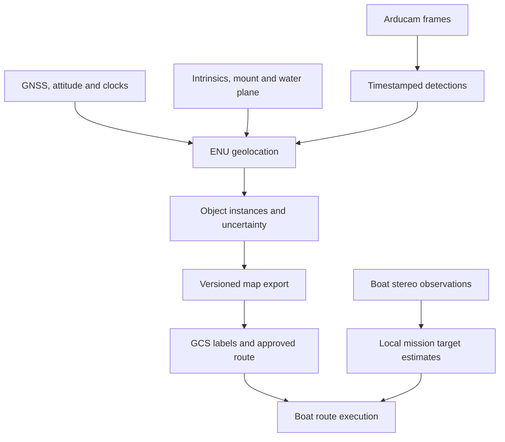

# Sensing and perception architecture

Last updated: 2026-11-04. A portable numerical implementation and synthetic demonstration
now exist under `drone/`; see [commands](../drone/README.md). Optional ROS package/launch
source exists but has not run. Hardware and physical accuracy remain unverified.

## Implemented standalone milestone

The actual entry point is `perception_synthetic.demo`: it generates explicit measurement
events, invokes `maritime_perception.replay` and then evaluates against separate truth.
Production modules do not read scene targets or truth. Shared config/state/frame contracts
also accept recorded or future hardware/Gazebo data; hardware failure never selects
synthetic data. `PerceptionPipeline` connects small numerical/source adapters rather than
one ROS node per class. The concrete file layout and replacement checklist are in README.

Implemented: raw/rectified camera rays and pixel-coordinate restoration; camera/antenna
lever arms; exposure-time pose resolution with gaps/reset checks; horizontal water
projection; correlated uncertainty; gated assignment with unmatched/ambiguous outcomes;
static/random-walk tracks; WGS84 and validated report files. Unknown required uncertainty
or calibration rejects observations rather than reporting zero uncertainty. Predictions
remain separately labeled when a frame is rejected. There is no CV/moving-object model.

The projector uses the research document's narrow non-ROS fallback: OpenCV plus a small
analytic intersection, SciPy SLERP/rotations and PROJ geodesy. Full IPM/tf2 evaluation is
still SP-34. Optional Ultralytics code requires local weights and leaves default box
centres unvalidated. Structural ROS conversions are tested; actual ROS/DDS/launch,
Docker, GPU/Jetson, camera/FCU and trained detection have not run.

Numerical/fixture evidence is in the test suite, not a physical acceptance claim.
The analytic scenario recovers three points exactly. The noisy survey retains three
same-class identities through misses, with no switches or mixed tracks, and retains
the configured 2.25 m^2 shared horizontal GNSS variance. Timestamp-derived 150 ms lag
is synthetic configuration, not measured runtime latency. Raw runs belong under ignored
`simulation/logs/perception/`; GCS behavior and boat/simulator sources are unchanged.

## Responsibility and data flow

Samuel owns the sensing/perception work under `drone/`: acquisition, water-object
detection, time-aligned geolocation, instance association and a consolidated object map.
Flight-control ownership stays with the drone/Pixhawk team. The GCS owns human review,
semantic labels, route planning and mission approval; the boat owns route execution.
Boat-mounted sensing is a distinct later integration with the boat team.

Internally keep ENU positions in meters; serialize WGS84 only when needed by external
consumers. An observation is one image-derived measurement. A track is an estimated
physical instance. A survey map is a versioned collection of tracks. A route contains
where the boat should travel; no route waypoints are emitted by the detector.

The existing design has one consolidated survey, operator review, drone landing,
then boat execution. Initial tests can use local map-file import. Radio transport,
continuous updates and automatic resurvey are not prerequisites for the first slice.
No direct boat-drone perception link is currently required.

The forwarded research brief adds live track/uncertainty reports and cross-pass
identities as development targets. Reports during the survey fit the existing plan;
continuous drone operation during boat navigation and automatic route changes remain
open decisions. See [uncertainty and tracking](uncertainty_tracking.md) for covariance,
motion/association choices, ellipse semantics and the required timing/status fields.

## Proposed internal modules

| Module | Inputs | Outputs | Key requirement |
| --- | --- | --- | --- |
| Acquisition | Camera/driver configuration | Frames + exposure-related time + calibration ID | Preserve pixel domain and clock meaning |
| Pose adapter/history | Position, quaternion, GNSS health and time sync | Pose at exposure, origin ID, quality | Explicit frame adaptation and gap rejection |
| Detector | Frame + model | Object boxes and optional geometry features | Return coordinates in calibrated image domain |
| Geolocation | Pixel/ray + pose + calibration + water plane | ENU hit + uncertainty/rejection | Pure, independently testable geometry |
| Association/map builder | Valid observations | Stable object instances and map revision | Same class may represent many instances |
| Export/transfer | Consolidated map | Validated JSON and delivery acknowledgement | Preserve origin, age, quality and identity |
| Recorder/replay | Raw streams + configurations | Reproducible sessions | Logging must not block acquisition |

Prefer plain Python core modules with thin ROS 2 adapters. ROS node/process count should
follow measured scheduling and memory needs; the table does not prescribe seven nodes.
Before implementing geometry/history arithmetic, read
[ROS 2 package research](ros2_geolocation_packages.md). Evaluate IPM for batched
pixel-to-plane projection and use tf2 for time-indexed transforms/interpolation.
Keep image/time/pose quality gates and map semantics in the Maritime adapter.
Use a linear KF as the first projected-ENU linear-motion tracker, with per-observation
covariance and shared-bias handling. Validate buoy attachment/motion before choosing
constant-velocity extrapolation. EKF/UKF is conditional on a nonlinear filter model.
Do not port the entire CUASC mission framework, MAVROS dependency or launcher scripts
unless needed by the confirmed drone integration. Boat direct-pymavlink use does not
automatically choose the drone telemetry adapter.

## Proposed end-to-end class contracts

Status: the original discussion contracts remain design guidance. The portable subset
described above is implemented; real acquisition, deployment, transport and performance
acceptance remain proposals. Ordinary GNSS without RTK is the confirmed sensor direction.

Camera and raw IMU are insufficient for absolute geolocation. Require timestamped GNSS,
earth-referenced attitude/heading and height above water, plus camera calibration.
Prefer the flight controller's validated fused state and record raw inputs for diagnosis.
If that state is unavailable, evaluate robot_localization and a heading source deliberately;
do not independently fuse correlated FCU outputs and their input IMU/GNSS.

| Class | Narrow responsibility | Main contract |
| --- | --- | --- |
| ArducamSource | Acquire frames and camera metadata | read() -> Frame; ID, source clock/exposure metadata, image domain/calibration ID |
| VehicleStateSource | Adapt the selected FCU/telemetry interface | adapt() -> VehicleState; pose/velocity, covariance or explicit unknown, source epoch, GNSS/estimator health |
| ClockMapper | Relate source clocks to the processing clock | map_time() -> TimestampEstimate; mapped time, uncertainty, mapping ID; retain raw time |
| PoseProvider | Retrieve camera pose at measurement time | at() -> PoseEstimate or rejection; tf2 transforms plus separate covariance, brackets/gaps, origin/reset status |
| CameraGeometry | Apply the calibrated pixel model | pixel_ray() -> optical ray; wrap image_geometry/OpenCV; raw and rectified domains explicit |
| ObjectDetector | Run YOLO and restore source coordinates | detect() -> DetectionBatch; class/score, boxes, frame ID/time; invert crop/tile/letterbox |
| TargetReferenceEstimator | Select the physical point to locate | locate() -> PixelReference; point, method, pixel uncertainty, reference-height hypothesis |
| WaterSurfaceProvider | Supply the modeled surface | at() -> PlaneEstimate; normal/elevation, uncertainty, source/datum/age |
| PlaneProjector | Intersect rays with the surface | project() -> Hit or rejection; evaluate IPM first; output frame/time and conditioning checks |
| ProjectionUncertainty | Propagate error through projection | propagate() -> ObservationDistribution; mean, random covariance, shared components and model validity |
| MapAnchorModel | Preserve common navigation/calibration error | describe() -> anchor/bias model with ID/epoch and covariance/unknown; no independent averaging |
| ObjectAssociator | Match observations to physical instances | assign() -> matches, unmatched and ambiguous hypotheses; same class can contain many objects |
| ObjectTracker | Estimate each object's state over time | update()/predict() -> Track; conditional local state/covariance, motion model, age and lifecycle |
| GeodeticConverter | Convert fixed ENU to/from WGS84 | forward()/reverse(); tested ECEF/ENU implementation and datum |
| ReportEncoder | Validate and serialize reports | encode() -> snapshot/live envelope; explicit epoch, covariance units and schema version |
| ReportTransport | Deliver complete versioned reports | send()/acknowledge(); transport deferred; retry/deduplication must preserve revision order |
| SessionRecorder | Preserve replay evidence asynchronously | record(); bounded queue, raw streams/configs, failures/drops and calibration/model IDs |

Use small immutable Frame, VehicleState, PoseEstimate, PixelReference, PlaneEstimate,
Observation and Track records with units, frame/origin ID, source epoch and provenance.
Validity is usable, degraded or rejected with reason; absent covariance is not a zero
matrix. A rejected hit has no geographic point. Separate helpers such as
invert_image_transform(), check_pose_gap(), check_intersection(), propagate_covariance()
and ellipse_from_covariance() from ROS callbacks and file/network operations.
Use composition; no detector/logger superclass owns the entire pipeline.

### One observation through the system

1. Capture the image and map its source timestamp. Resolve matching calibration and
   distinguish exposure midpoint from host arrival. Preserve row timing if available.
2. Run YOLO, retaining the image ID/time. Restore every selected point to calibrated
   source-image coordinates. Deduplicate tile outputs before object association.
3. Select the buoy reference point, including uncertainty and any freeboard assumption.
   Bottom-centre of an overhead box is not generally the water-centre.
4. Resolve camera pose and water plane at exposure. Enforce clock, heading, height,
   source-gap, covariance and origin continuity policies.
5. Project the batch to ENU with IPM or the evaluated fallback. Reject wrong-way,
   near-horizon, nonfinite or out-of-envelope hits before claiming Gaussian uncertainty.
6. Propagate the joint error model. Keep shared GNSS/heading/height/calibration terms
   identifiable across observations and objects. Use an approximate Gaussian only
   where Monte Carlo/replay supports that approximation.
7. Associate observations, update the object's motion model, and predict to the explicit
   reporting epoch. Ambiguity remains visible.
8. Derive WGS84 centres and optional ellipse boundaries at export; validate and deliver
   the report. Retain replay evidence and a final consolidated survey snapshot.

### Ordinary-GNSS mapping and accuracy

Keep a fixed numerical ENU origin. It need not be surveyed to run the mathematics, but
an origin selected from noisy GNSS is not ground truth. Preserve anchoring uncertainty
without counting the same position error twice.

Keep local object-shape/spacing uncertainty distinct from the uncertain global anchor
and its time-varying drift. Use a smooth local odometry frame only if the FCU supplies
a documented continuous estimate; do not interpolate across estimator resets. If map
anchoring is refined, update affected objects consistently in an explicit map revision
while retaining the fixed ENU definition.

For a prototype, evaluate correlation-aware batching and a measured common-error floor.
Do not feed every marginal GNSS covariance to independent object filters and then claim
absolute precision. If this approximation fails coverage tests, evaluate joint anchor/bias
states or fixed-lag smoothing. A bias state alone cannot make absolute translation
observable. See [uncertainty](uncertainty_tracking.md) for composition and correlations.

Prefer near-nadir views, low blur and measured timestamps/mounts over filter complexity.
Verify height above water and heading. Barometer + measured launch/deck-to-water offset
is a candidate height baseline, with drift included. Range sensors and VIO/optical flow
over moving/glinting water require separate evaluation. Measured fixed visual references
may improve anchoring if their coordinates/geometry are accurate and observable.

No physical accuracy guarantee follows from this architecture. Set operating limits and
navigation margins from held-out residuals and coverage. Ordinary GNSS may dominate
absolute error even when the local map is repeatable.

### Proposed ROS 2 and Docker layout

Start with one drone application container and approximately five ROS processes:
capture; selected telemetry/pose adapter; detector; geolocation plus mapping; and export.
Run rosbag2/SessionRecorder alongside them with bounded asynchronous queues.
These are scheduling proposals; each class does not require its own node.

Use sensor_msgs/Image + CameraInfo, sensor_msgs/Imu/NavSatFix when supplied,
nav_msgs/Odometry or PoseWithCovarianceStamped for the authoritative state,
vision_msgs/Detection2DArray, TF and diagnostics where suitable. A small proposed Maritime
observation/track message must additionally preserve frame identity, covariance/bias
provenance, rejection and track status. JSON is the export boundary, not image transport.

Use sensor-data QoS with shallow bounded image queues. Drop obsolete inference work
rather than accumulating latency. Retain pose history for measured inference delay and
a bounded wait for an after-sample. Stale extrapolation must be explicit. TF contains
transforms, not covariance or GNSS health; retain these alongside TF. Do not linearly
blend covariance matrices and call that propagation without a stated model.

Host camera/kernel drivers, FCU firmware and NVIDIA runtime stay outside the app.
Pin a tested JetPack/CUDA/TensorRT/ROS/Arducam matrix; do not copy desktop binaries to
aarch64 or choose ROS Jazzy solely because the boat uses it. Library-backed Python with
NumPy/OpenCV, IPM, tf2 and a thin Ultralytics/TensorRT wrapper is a candidate pending
benchmarks. Build/validate engines on a compatible target stack and compare exported
pixel accuracy. Optimize copies or move code to C++ after profiling.

### Development slices and acceptance

First replay manually annotated pixels with synthetic/recorded pose into an ENU
distribution and JSON file. Then add real camera timing/calibration, YOLO and instance
fusion, followed by GCS import and measured radio delivery. A trained model is not needed
to test geometry. Detailed acceptance remains in SP-01..SP-40 and SP-41..SP-44.

Require synthetic geometry/geodesy checks; surveyed land targets; hover/moving flights
with GNSS/height/heading logs; then held-out water surveys. Measure bias/p95 error, recall,
merge/split rates, ellipse coverage/area, age/latency, drops and sustained Jetson load.
A 95% ellipse is not a guaranteed bound. Local tape/total-station geometry can validate
relative mapping without RTK; absolute WGS84 accuracy needs an independently known
reference with quantified uncertainty.

Discussion checks on 2026-11-04 reproduced the current CUASC centre-ray counterexample
under the documented ROS frame contract, checked the example proper mount rotation and
rays at two headings, compared camera-position/ray/water Jacobians with finite differences,
and checked shared-error averaging and ellipse numerics. Both contract JSON examples
parsed; the new covariance and rounded ellipse axes agreed. A seeded 100,000-sample
Gaussian experiment gave 94.951% coverage for the nominal 95% ellipse. These are isolated
calculations and fixtures, not ROS/IPM integration or physical uncertainty acceptance.

### Sources checked for this discussion

- [ROS NavSatFix: antenna, ellipsoid and ENU covariance](https://github.com/ros2/common_interfaces/blob/jazzy/sensor_msgs/msg/NavSatFix.msg)
- [ROS Imu: unavailable orientation and unknown covariance](https://github.com/ros2/common_interfaces/blob/jazzy/sensor_msgs/msg/Imu.msg)
- [ArduPilot EKF overview](https://ardupilot.org/copter/docs/common-apm-navigation-extended-kalman-filter-overview.html)
- [IPM library tutorial](https://ipm-docs.readthedocs.io/en/latest/tutorial.html)
- [GPS.gov user accuracy factors](https://www.gps.gov/gps-accuracy)
- Existing [package research](ros2_geolocation_packages.md) provides pin candidates and limits.

## CV scope and dataset

The first aerial output is location of relevant objects, with buoy color `unknown`
allowed. One buoy class across colors is reasonable. A learned detector detects the
object distribution it was trained for; it is not guaranteed to discover arbitrary
new water objects. Decide whether floating case/target/debris need additional classes.

The provided photos show upright fender buoys with dark ends, variable exposure,
pool and outdoor backgrounds, and strong reflected silhouettes. They are useful visual
references, not a sufficient downward-looking training/test dataset.

Collect deployed-camera views over expected height, tilt, motion, illumination and
water conditions. Include black/white/striped and uncommon-color buoys where relevant.
Label the physical body consistently; avoid training reflections as second buoys.
Include empty water, glint, wakes, shadows, dock/boat edges and partial objects as negatives.
Keep flight/day/location splits separate to avoid leakage from near-identical frames.
Store annotation policy, dataset versions, class mapping, train config and portable weights.

Use YOLO26n as the user's selected baseline. Begin with bounding boxes; add keypoints/masks only if measured geolocation bias warrants
them. Center-of-box is a baseline reference with a documented height/reflection bias.
Manual color labels should remain distinct from model predictions and course-role labels.

Report detector precision/recall by size/view/lighting, false detections per area/time,
and survey-level object recall. mAP alone does not establish a complete usable map.
Measure chosen-pixel error as well as detection success. Test inverse preprocessing:
tiles, crop offsets, scaling and letterboxing must resolve to the correct camera pixels.

## Coverage at less than 5 m

Low altitude increases projected object size but narrows footprint. At ideal nadir,
footprint width is approximately `2 H tan(horizontal_FOV/2)`, with H measured above
the water. Use calibrated optics to compute it, then test overlap, coverage speed,
usable image margins and oblique views. No minimum altitude or survey speed is selected.
Measure blur, rolling-shutter sensitivity, tilt, flight time and exposure delay.

Plan repeated useful views of each object. Adjacent frames are correlated; repeated
views with different geometry help identify biases. Boundary objects and masked
regions require explicit coverage checks. The rough course drawing can guide review,
but cannot prove all physical obstacles were observed or accurately positioned.

## Jetson deployment

Both vehicles are planned for Orin Nano 8GB; CPU/GPU share memory rather than having
8GB exclusively available to inference. Record the actual JetPack/CUDA/TensorRT,
Python/ROS, carrier, power mode, driver and camera combination before selecting builds.
Do not assume the desktop ROS Jazzy setup is directly deployable on the Jetson.

Retain source weights and export configuration; build and validate inference artifacts
on a compatible target stack. YOLO26n is the selected new baseline, while the legacy
engine filename alone still does not establish its training recipe or artifact provenance.
Evaluate the current yolo_ros wrapper against a thin Ultralytics/TensorRT adapter;
its standard x64 GPU install is not proof of Jetson/aarch64 GPU support.

Benchmark full-frame inference versus tiling at the intended object sizes. Bound capture,
detector, pose and logging queues. Prefer retaining only the frames needed for outstanding
detections rather than an arbitrary 100-frame 4K ring. Account for middleware copies,
rectification, monitor streams, recording and model workspace. Measure sustained p50/p95
latency, accepted geolocations/sec, dropped frames, memory, thermals, storage and power
under the full workload; no FPS target has yet been agreed.

## Boat perception

User proposes two ZED Mini cameras; old hardware notes mention ZED X Mini. Confirm exact
SKU/serials, interfaces and two-camera support before implementation. A stereo camera
already has an internal baseline; two camera units are not automatically one wider
stereo pair. Cross-unit fusion needs calibrated mounts and suitable time alignment.

Start with local boat-frame bearing/range of the actual buoy/target. Validate depth on
object surfaces, excluding water/reflections and invalid returns. Quantify errors by
range, sun and boat motion; propagate camera-to-boat/mechanism offsets. Launch requires
target/dock geometry and calibrated launcher dynamics, not just distance to the black
marker buoy. Color/striped-target classification is more important in these close tasks.

## References

- [Geolocation and experiments](geolocation.md)
- [Perception contract](perception_contract.md)
- [Task backlog](../drone/TASKS.md)
- [NVIDIA CUDA for Tegra: shared CPU/GPU DRAM](https://docs.nvidia.com/cuda/cuda-for-tegra-appnote/index.html)

