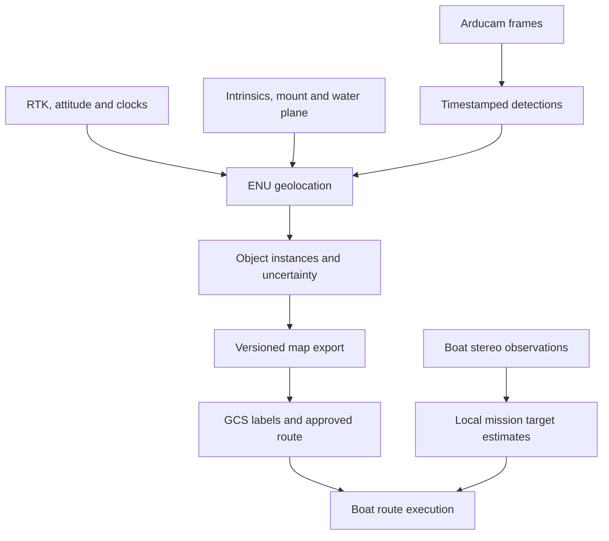

# Sensing and perception architecture

Last updated: 2026-11-01. User direction is recorded below; module boundaries are
proposed implementation guidance. No new ROS packages or network services exist yet.

## Responsibility and data flow

Samuel owns the sensing/perception work under `drone/`: acquisition, water-object
detection, time-aligned geolocation, instance association and a consolidated object map.
Flight-control ownership stays with the drone/Pixhawk team. The GCS owns human review,
semantic labels, route planning and mission approval; the boat owns route execution.
Boat-mounted sensing is a distinct later integration with the boat team.

Internally keep ENU positions in meters; serialize WGS84 only when needed by external
consumers. An observation is one image-derived measurement. A track is an estimated
physical instance. A survey map is a versioned collection of tracks. A route contains
where the boat should travel; no route waypoints are emitted by the detector.

The existing design has one consolidated survey, operator review, drone landing,
then boat execution. Initial tests can use local map-file import. Radio transport,
continuous updates and automatic resurvey are not prerequisites for the first slice.
No direct boat-drone perception link is currently required.

The forwarded research brief adds live track/uncertainty reports and cross-pass
identities as development targets. Reports during the survey fit the existing plan;
continuous drone operation during boat navigation and automatic route changes remain
open decisions. See [uncertainty and tracking](uncertainty_tracking.md) for covariance,
motion/association choices, ellipse semantics and the required timing/status fields.

## Proposed internal modules

| Module | Inputs | Outputs | Key requirement |
| --- | --- | --- | --- |
| Acquisition | Camera/driver configuration | Frames + exposure-related time + calibration ID | Preserve pixel domain and clock meaning |
| Pose adapter/history | Position, quaternion, RTK health and time sync | Pose at exposure, origin ID, quality | Explicit frame adaptation and gap rejection |
| Detector | Frame + model | Object boxes and optional geometry features | Return coordinates in calibrated image domain |
| Geolocation | Pixel/ray + pose + calibration + water plane | ENU hit + uncertainty/rejection | Pure, independently testable geometry |
| Association/map builder | Valid observations | Stable object instances and map revision | Same class may represent many instances |
| Export/transfer | Consolidated map | Validated JSON and delivery acknowledgement | Preserve origin, age, quality and identity |
| Recorder/replay | Raw streams + configurations | Reproducible sessions | Logging must not block acquisition |

Prefer plain Python core modules with thin ROS 2 adapters. ROS node/process count should
follow measured scheduling and memory needs; the table does not prescribe seven nodes.
Before implementing geometry/history arithmetic, read
[ROS 2 package research](ros2_geolocation_packages.md). Evaluate IPM for batched
pixel-to-plane projection and use tf2 for time-indexed transforms/interpolation.
Keep image/time/pose quality gates and map semantics in the Maritime adapter.
Use a linear KF as the first projected-ENU linear-motion tracker, with per-observation
covariance and shared-bias handling. Validate buoy attachment/motion before choosing
constant-velocity extrapolation. EKF/UKF is conditional on a nonlinear filter model.
Do not port the entire CUASC mission framework, MAVROS dependency or launcher scripts
unless needed by the confirmed drone integration. Boat direct-pymavlink use does not
automatically choose the drone telemetry adapter.

## CV scope and dataset

The first aerial output is location of relevant objects, with buoy color `unknown`
allowed. One buoy class across colors is reasonable. A learned detector detects the
object distribution it was trained for; it is not guaranteed to discover arbitrary
new water objects. Decide whether floating case/target/debris need additional classes.

The provided photos show upright fender buoys with dark ends, variable exposure,
pool and outdoor backgrounds, and strong reflected silhouettes. They are useful visual
references, not a sufficient downward-looking training/test dataset.

Collect deployed-camera views over expected height, tilt, motion, illumination and
water conditions. Include black/white/striped and uncommon-color buoys where relevant.
Label the physical body consistently; avoid training reflections as second buoys.
Include empty water, glint, wakes, shadows, dock/boat edges and partial objects as negatives.
Keep flight/day/location splits separate to avoid leakage from near-identical frames.
Store annotation policy, dataset versions, class mapping, train config and portable weights.

Use YOLO26n as the user's selected baseline. Begin with bounding boxes; add keypoints/masks only if measured geolocation bias warrants
them. Center-of-box is a baseline reference with a documented height/reflection bias.
Manual color labels should remain distinct from model predictions and course-role labels.

Report detector precision/recall by size/view/lighting, false detections per area/time,
and survey-level object recall. mAP alone does not establish a complete usable map.
Measure chosen-pixel error as well as detection success. Test inverse preprocessing:
tiles, crop offsets, scaling and letterboxing must resolve to the correct camera pixels.

## Coverage at less than 5 m

Low altitude increases projected object size but narrows footprint. At ideal nadir,
footprint width is approximately `2 H tan(horizontal_FOV/2)`, with H measured above
the water. Use calibrated optics to compute it, then test overlap, coverage speed,
usable image margins and oblique views. No minimum altitude or survey speed is selected.
Measure blur, rolling-shutter sensitivity, tilt, flight time and exposure delay.

Plan repeated useful views of each object. Adjacent frames are correlated; repeated
views with different geometry help identify biases. Boundary objects and masked
regions require explicit coverage checks. The rough course drawing can guide review,
but cannot prove all physical obstacles were observed or accurately positioned.

## Jetson deployment

Both vehicles are planned for Orin Nano 8GB; CPU/GPU share memory rather than having
8GB exclusively available to inference. Record the actual JetPack/CUDA/TensorRT,
Python/ROS, carrier, power mode, driver and camera combination before selecting builds.
Do not assume the desktop ROS Jazzy setup is directly deployable on the Jetson.

Retain source weights and export configuration; build and validate inference artifacts
on a compatible target stack. YOLO26n is the selected new baseline, while the legacy
engine filename alone still does not establish its training recipe or artifact provenance.
Evaluate the current yolo_ros wrapper against a thin Ultralytics/TensorRT adapter;
its standard x64 GPU install is not proof of Jetson/aarch64 GPU support.

Benchmark full-frame inference versus tiling at the intended object sizes. Bound capture,
detector, pose and logging queues. Prefer retaining only the frames needed for outstanding
detections rather than an arbitrary 100-frame 4K ring. Account for middleware copies,
rectification, monitor streams, recording and model workspace. Measure sustained p50/p95
latency, accepted geolocations/sec, dropped frames, memory, thermals, storage and power
under the full workload; no FPS target has yet been agreed.

## Boat perception

User proposes two ZED Mini cameras; old hardware notes mention ZED X Mini. Confirm exact
SKU/serials, interfaces and two-camera support before implementation. A stereo camera
already has an internal baseline; two camera units are not automatically one wider
stereo pair. Cross-unit fusion needs calibrated mounts and suitable time alignment.

Start with local boat-frame bearing/range of the actual buoy/target. Validate depth on
object surfaces, excluding water/reflections and invalid returns. Quantify errors by
range, sun and boat motion; propagate camera-to-boat/mechanism offsets. Launch requires
target/dock geometry and calibrated launcher dynamics, not just distance to the black
marker buoy. Color/striped-target classification is more important in these close tasks.

## References

- [Geolocation and experiments](geolocation.md)
- [Perception contract](perception_contract.md)
- [Task backlog](../drone/TASKS.md)
- [NVIDIA CUDA for Tegra: shared CPU/GPU DRAM](https://docs.nvidia.com/cuda/cuda-for-tegra-appnote/index.html)

